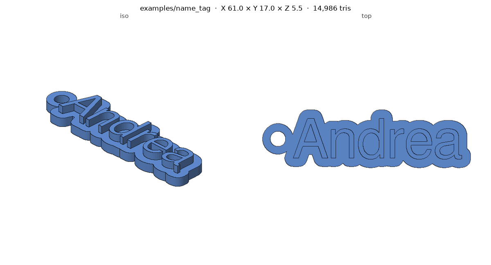
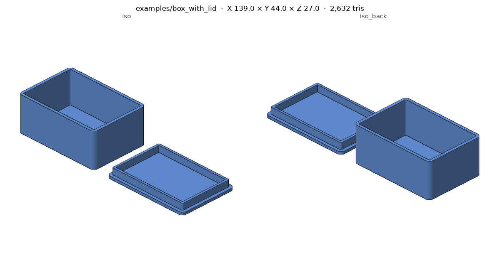
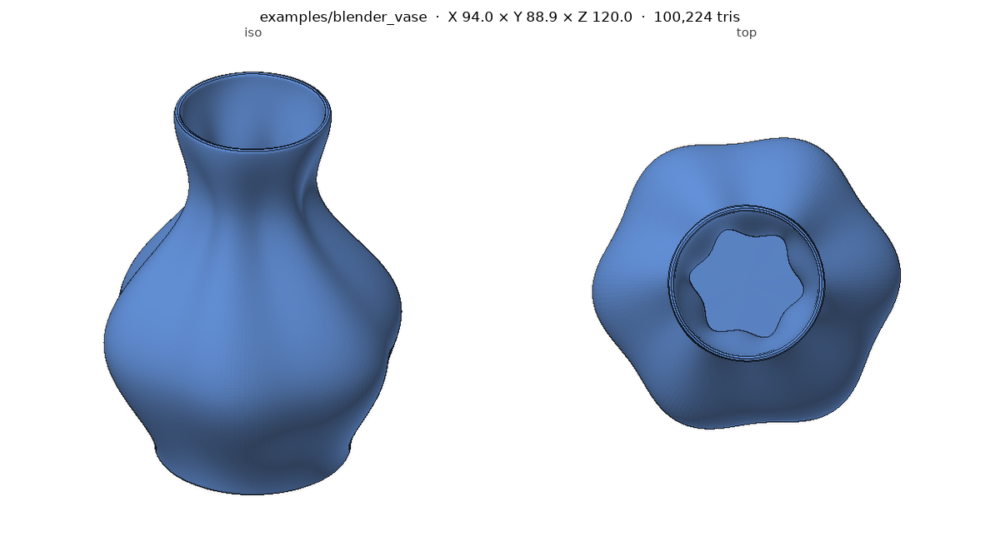
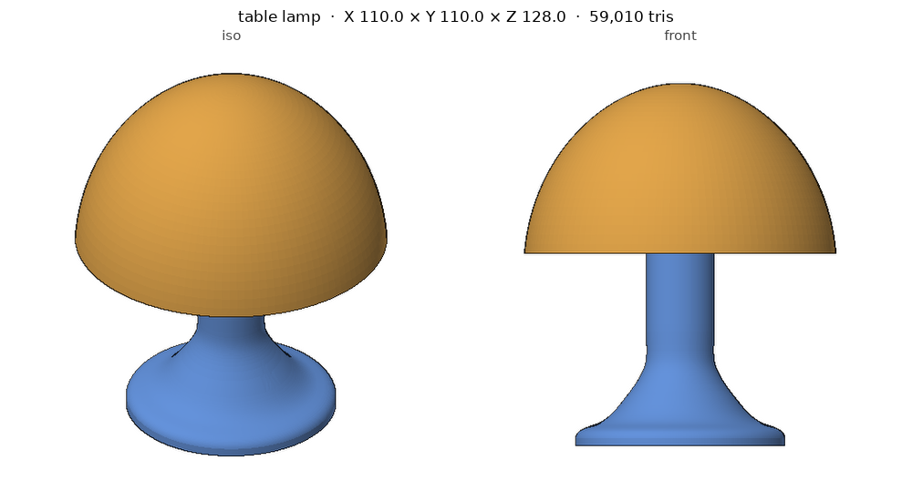
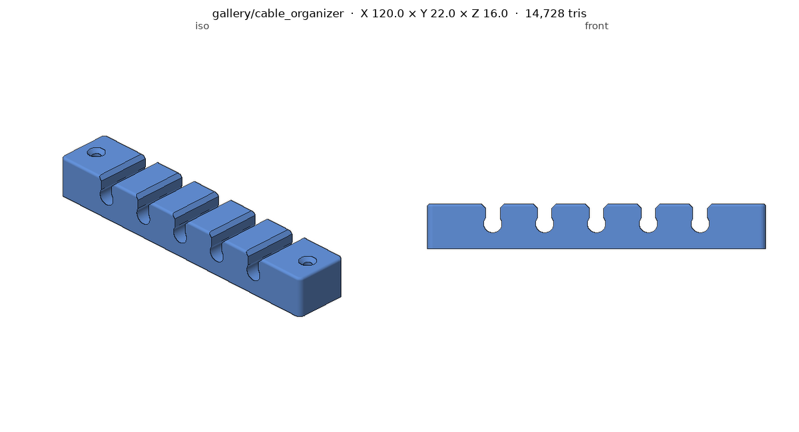
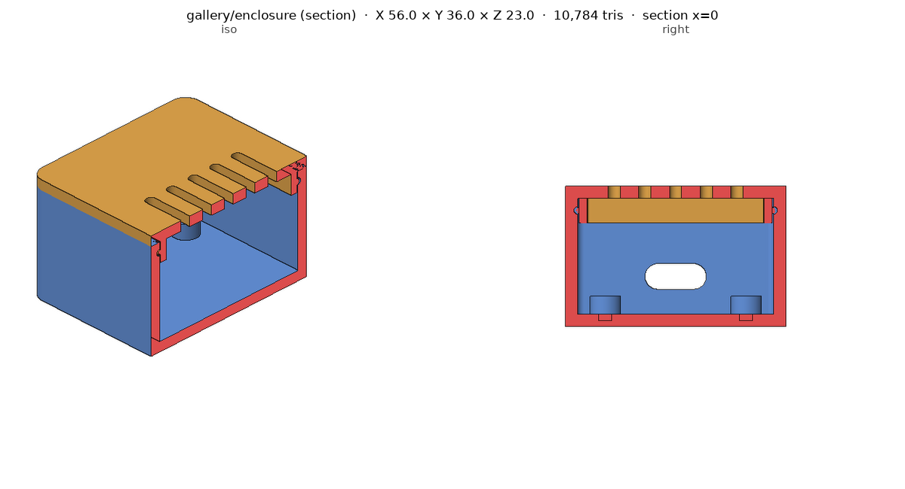
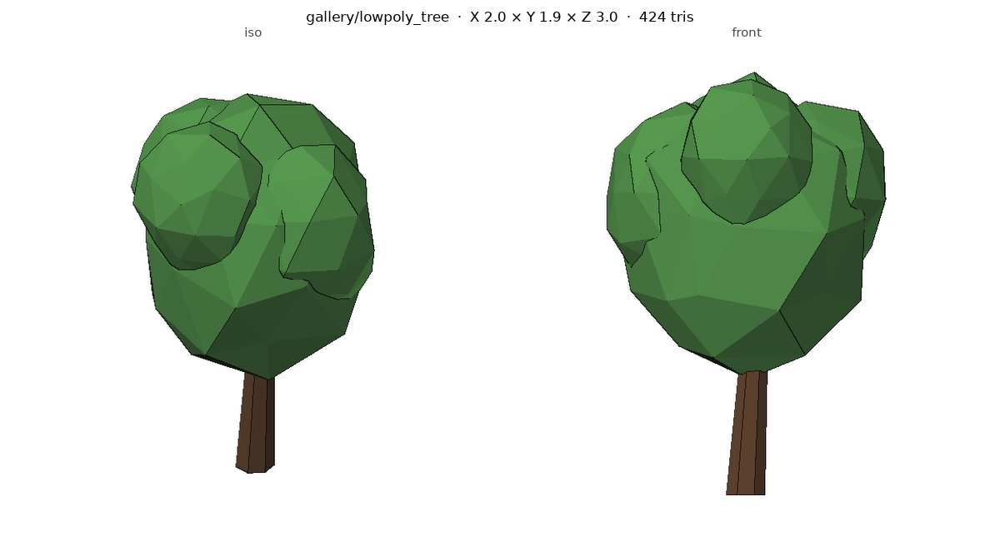

# AI 코딩 에이전트용 3D 모델링 스킬

[English](README.md)

설명, 스케치, 참고 이미지를 받아 **STEP · STL · 3MF · OBJ · GLB · .blend** 파일로 완성된
3D 모델을 만들어 주는 [Agent Skill](https://github.com/vercel-labs/skills)입니다.
Claude, Codex, Cursor, Gemini CLI 등에서 쓸 수 있고, 3D 프린팅, CAD, 렌더링, 웹, 게임 어디에 쓰든 동작합니다.

| 코드 CAD (파라메트릭) | 공차를 넣은 2파트 조립품 | Blender 절차적 모델링 |
|---|---|---|
|  |  |  |

## 스킬이 하는 일

1. 용도, 실제 치수, 스타일을 정하고 가정한 내용을 밝힙니다.
2. 대상에 맞는 방식을 고릅니다.

   | 대상 | 방식 |
   |---|---|
   | 치수가 있는 부품, 케이스, 거치대, 이름표 | **코드 CAD**: build123d, CadQuery, OpenSCAD |
   | 유기적·절차적 형태, 장면, 렌더 | **Blender** `bpy`: MCP로 실행 중인 Blender를 조작하거나 headless로 실행 |
   | Fusion에서 계속 편집할 설계 | **Autodesk Fusion**: MCP 또는 Fusion API 스크립트 |
   | 캐릭터, 동물, 사실적인 소품 | **AI 생성**: Meshy, Tripo, Hyper3D, Hunyuan3D로 만든 뒤 정리 |

3. 큰 형태부터 잡고 작은 단계로 다듬습니다.
4. **모든 결과를 검사하고 직접 봅니다.** 함께 들어 있는 스크립트로 구멍 없이 닫혔는지,
   크기, 분리된 바디, 벽 두께를 확인하고, GPU 없이 여러 방향 미리보기 이미지를 만듭니다.
5. 소스(스크립트, .blend, Fusion 설계), 용도에 맞는 내보내기 파일, 미리보기,
   수정할 수 있는 파라미터 목록을 함께 전달합니다.

## 갤러리

에이전트가 한 줄짜리 요청만 받고 이 스킬을 따라 만든 결과입니다. 스크립트, 요청 문장,
가정한 내용은 [`gallery/`](gallery/)에 있습니다.

| 테이블 조명 (2색) | 케이블 정리기 | 스냅핏 케이스 (단면) | 로우폴리 게임용 나무 (GLB) |
|---|---|---|---|
|  |  |  |  |

## 설치

[Agent Skills](https://github.com/vercel-labs/skills) 형식(`SKILL.md` 폴더)을 지원하는 에이전트라면
어디서나 동작합니다. **Claude Code, Codex, Cursor, Gemini CLI, GitHub Copilot, OpenCode,
Windsurf** 등입니다.

**모든 에이전트: `npx skills`** (권장)

```bash
npx skills add uulab-official/3d-modeling-skills                 # 설치할 에이전트를 골라서 설치
npx skills add uulab-official/3d-modeling-skills -a codex -a claude-code
```

**모든 에이전트: 설치 스크립트** (Node 없이 설치)

```bash
curl -fsSL https://raw.githubusercontent.com/uulab-official/3d-modeling-skills/main/install.sh | bash
# 클론했다면: ./install.sh claude codex | ./install.sh --project codex | ./install.sh --link all
```

| 에이전트 | 플러그인 / 확장 | 설치되는 스킬 폴더 |
|---|---|---|
| Claude Code | `/plugin marketplace add uulab-official/3d-modeling-skills` 실행 후 `/plugin install 3d-modeling@3d-modeling-skills` | `~/.claude/skills/` |
| Codex | 플러그인 매니페스트는 `.codex-plugin/`, 마켓플레이스는 `.agents/plugins/` | `~/.agents/skills/` (`$3d-modeling`으로 호출) |
| Cursor | — | `~/.cursor/skills/` |
| Gemini CLI | `gemini extensions install https://github.com/uulab-official/3d-modeling-skills` | `~/.gemini/skills/` |
| GitHub Copilot | — | `~/.copilot/skills/` |
| OpenCode | — | `~/.config/opencode/skills/` |
| Claude 앱 (claude.ai, 데스크톱, Cowork) | `skills/3d-modeling`을 zip으로 묶어 설정 → 기능에서 업로드 | — |

프로젝트 단위로 설치하면 저장소 안의 `.agents/skills/`(또는 `.claude/skills/`)에 들어가서
팀원 모두가 같은 스킬을 씁니다.

**Python 의존성**: 스킬이 필요할 때 설치하며, 미리 설치해도 됩니다.

```bash
pip install -r requirements.txt
```

### 선택 백엔드

| 백엔드 | 설정 |
|---|---|
| Blender (실행 중인 앱 조작) | [Blender](https://www.blender.org/download/)를 설치한 뒤 `uvx mcp-for-blender setup`을 실행하고, Blender 사이드바 BlenderMCP 탭에서 **Connect** |
| Blender (headless) | `PATH`에 Blender를 두거나 `BLENDER_PATH`를 지정, 또는 `pip install bpy` |
| Autodesk Fusion | Fusion MCP 애드인을 쓰거나, 생성된 API 스크립트를 *스크립트 및 애드인*에서 실행 |
| Meshy | [`@meshy-ai/meshy-mcp-server`](https://www.npmjs.com/package/@meshy-ai/meshy-mcp-server)와 `MESHY_API_KEY` |

사용할 수 있는 백엔드 확인: `python skills/3d-modeling/scripts/check_env.py`

## 사용 예시

> 책상 케이블 정리기 만들어줘. 길이 120mm, 6mm 케이블 슬롯 5개, M3 나사 구멍.

> 50 × 30 × 15mm 보드용 2파트 케이스. 스냅핏 뚜껑에 USB-C 구멍.

> three.js 장면용 로우폴리 여우, 5천 삼각형 이하 GLB로.

> 이 피규어 사진을 높이 80mm 원형 받침에 내 이름을 넣어서 출력 가능한 모델로.

## 기여

구조와 규칙은 [AGENTS.md](AGENTS.md)에 있습니다. 코딩 에이전트도 이 저장소를 수정할 때 이 파일을 읽습니다.

## 개발

```bash
pip install -r requirements.txt
python tests/validate_repo.py       # 매니페스트와 스킬 메타데이터 검사
tests/run_examples.sh               # bpy나 Blender가 있으면 --with-blender 추가
```

## 라이선스

[MIT](LICENSE). 생성한 모델은 만든 사람에게 속합니다. 스킬을 통해 쓰는 에셋과
AI 서비스는 각자의 라이선스와 약관을 따릅니다.
