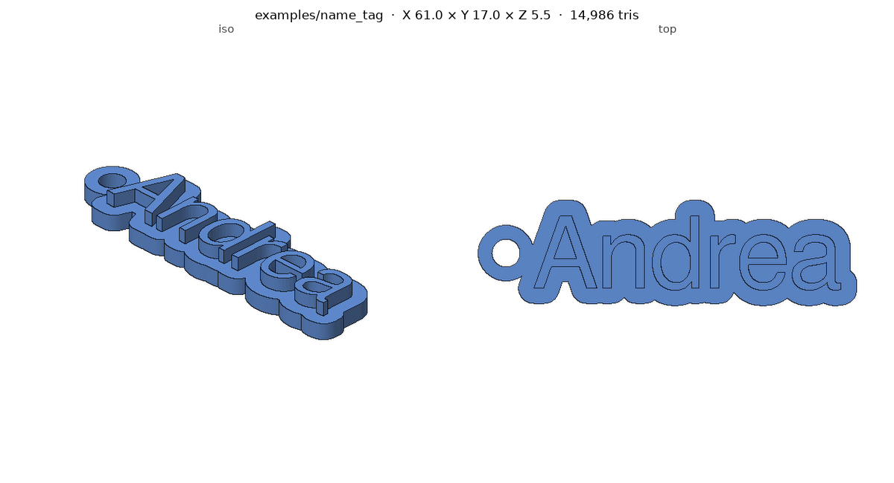
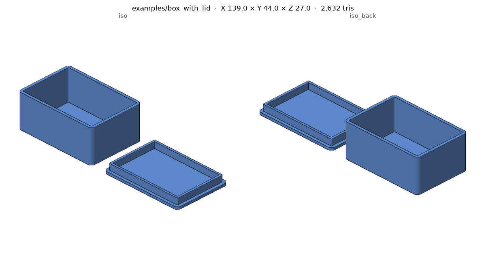
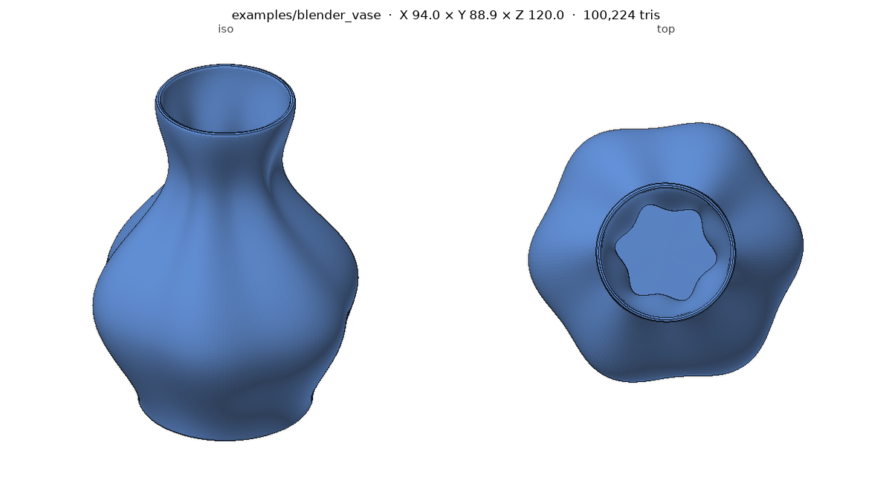
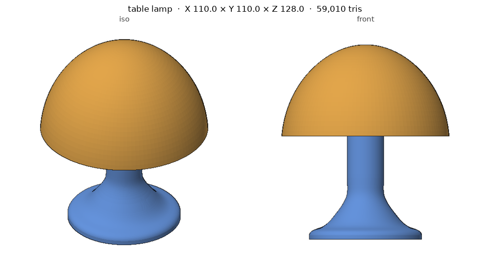
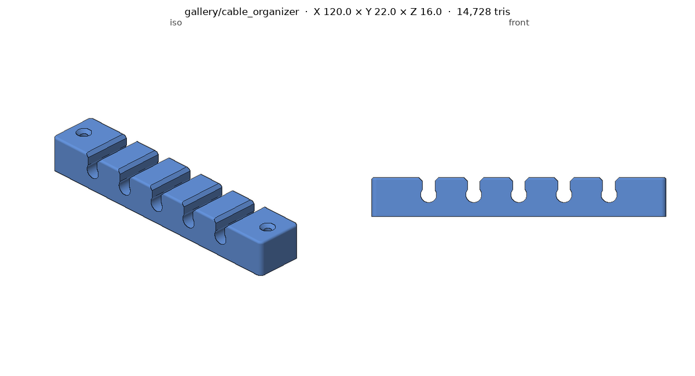
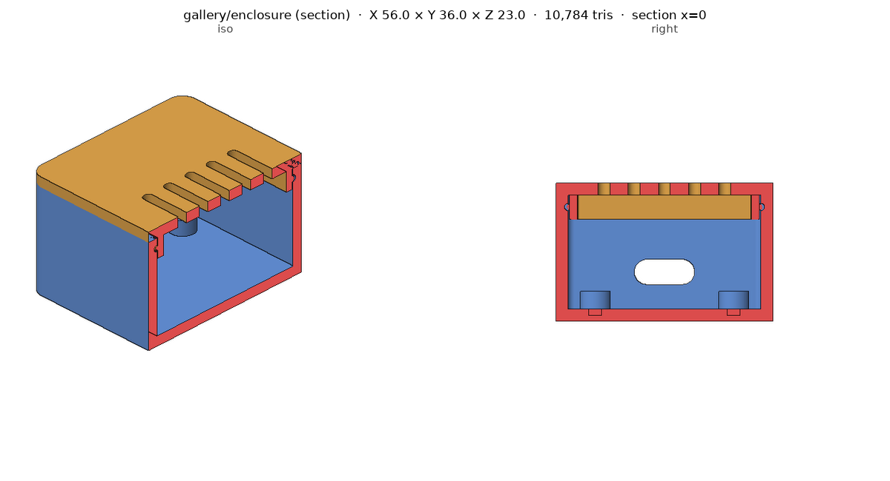
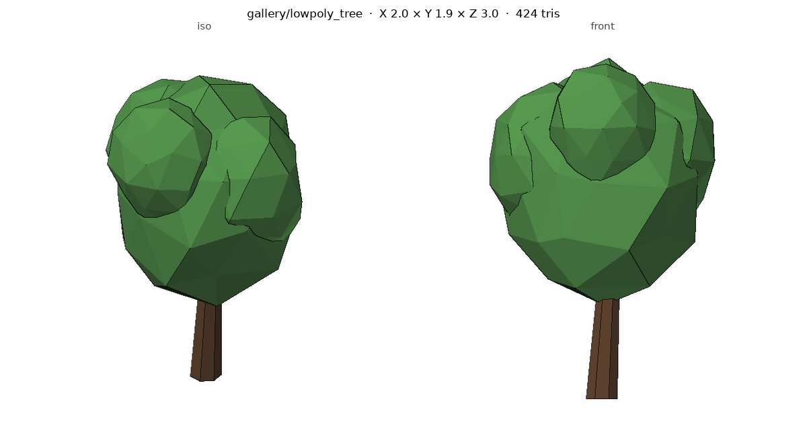

# 3D Modeling Skills for AI coding agents

[한국어](README.ko.md)

An [Agent Skill](https://github.com/vercel-labs/skills) for Claude, Codex, Cursor, Gemini CLI and
other coding agents that turns a description, sketch or reference image into a finished, checked 3D model:
**STEP, STL, 3MF, OBJ, GLB or .blend**, for 3D printing, CAD, rendering, the web or games.

| Parametric code CAD | Multi-part with fit clearance | Procedural Blender |
|---|---|---|
|  |  |  |

## What the skill does

1. Pins down the spec (purpose, real dimensions, style) and states its assumptions.
2. Picks the right approach for the object:

   | Object | Approach |
   |---|---|
   | Dimensioned parts, enclosures, mounts, text plates | **Code CAD** — [build123d](https://github.com/gumyr/build123d) / CadQuery / OpenSCAD |
   | Organic or procedural shapes, scenes, renders | **Blender** via `bpy` — live through a Blender MCP or headless |
   | Editable designs in Fusion | **Autodesk Fusion** via MCP or a Fusion API script |
   | Characters, animals, realistic props | **AI generation** — Meshy, Tripo, Hyper3D, Hunyuan3D — then cleanup |

3. Blocks out, then refines in small steps.
4. **Validates and looks at every result** with the bundled scripts: watertightness,
   size, separate bodies and wall thickness, plus a headless multi-view render.
5. Delivers the source (script, .blend or Fusion design), the exports the purpose needs,
   a preview image and the list of editable parameters.

## Gallery

Built by an agent following the skill from a one-line prompt; scripts, prompts and
assumptions are in [`gallery/`](gallery/).

| Table lamp (2 colours) | Cable organiser | Snap-fit enclosure (section view) | Low-poly game tree (GLB) |
|---|---|---|---|
|  |  |  |  |

## Install

Works with any agent that supports [Agent Skills](https://github.com/vercel-labs/skills)
(`SKILL.md` folders): **Claude Code, Codex, Cursor, Gemini CLI, GitHub Copilot,
OpenCode, Windsurf** and more.

**Any agent — `npx skills`** (recommended)

```bash
npx skills add uulab-official/3d-modeling-skills                 # pick agents interactively
npx skills add uulab-official/3d-modeling-skills -a codex -a claude-code
```

**Any agent — install script** (no Node needed)

```bash
curl -fsSL https://raw.githubusercontent.com/uulab-official/3d-modeling-skills/main/install.sh | bash
# or from a clone: ./install.sh claude codex | ./install.sh --project codex | ./install.sh --link all
```

| Agent | Plugin / extension | Skill folder used by the installers |
|---|---|---|
| Claude Code | `/plugin marketplace add uulab-official/3d-modeling-skills` then `/plugin install 3d-modeling@3d-modeling-skills` | `~/.claude/skills/` |
| Codex | plugin manifest in `.codex-plugin/` and marketplace in `.agents/plugins/` | `~/.agents/skills/` (use with `$3d-modeling`) |
| Cursor | — | `~/.cursor/skills/` |
| Gemini CLI | `gemini extensions install https://github.com/uulab-official/3d-modeling-skills` | `~/.gemini/skills/` |
| GitHub Copilot | — | `~/.copilot/skills/` |
| OpenCode | — | `~/.config/opencode/skills/` |
| Claude apps (claude.ai, desktop, Cowork) | zip `skills/3d-modeling` and upload it in Settings → Capabilities | — |

Project-scoped installs go to `.agents/skills/` (or `.claude/skills/`) in the repo, so
the whole team gets the skill.

**Python dependencies** (the skill installs what it needs on demand, or up front):

```bash
pip install -r requirements.txt
```

### Optional backends

| Backend | Setup |
|---|---|
| Blender (live) | Install [Blender](https://www.blender.org/download/), then `uvx mcp-for-blender setup` and press **Connect** in Blender's BlenderMCP sidebar |
| Blender (headless) | Blender on `PATH` (or `BLENDER_PATH`), or `pip install bpy` |
| Autodesk Fusion | A Fusion MCP server add-in, or run the generated API script in *Scripts and Add-Ins* |
| Meshy | [`@meshy-ai/meshy-mcp-server`](https://www.npmjs.com/package/@meshy-ai/meshy-mcp-server) with `MESHY_API_KEY` |

Check what is available with `python skills/3d-modeling/scripts/check_env.py`.

## Try it

> Make a desk cable organiser: 120 mm long, five slots for 6 mm cables, screw holes for M3.

> Design a two-part box for a 50 × 30 × 15 mm board, with a snap-fit lid and a USB-C cutout.

> Model a low-poly fox for a three.js scene, under 5k triangles, as GLB.

> Turn this photo of a figurine into a printable model 80 mm tall on a round base with my name.

## Repository layout

```
skills/3d-modeling/
  SKILL.md                  workflow, approach selection, conventions
  references/               code-cad, blender, fusion, ai-generation, formats-and-qa
  scripts/                  check_env, inspect_mesh, render_views, convert
  templates/                build123d_part.py, blender_build.py
examples/                   name_tag, box_with_lid, blender_vase
gallery/                    dogfooding results: cable_organizer, enclosure, lowpoly_tree
tests/                      validate_repo.py, run_examples.sh (CI)
install.sh                  installs the skill into any agent
.claude-plugin/ .codex-plugin/ .agents/plugins/ gemini-extension.json   per-agent manifests
```

## Scripts

```bash
S=skills/3d-modeling/scripts
python $S/inspect_mesh.py part.stl --expect 60x40x10 --thickness --min-wall 1.2 --overhang 45
python $S/render_views.py part.stl --views iso,front,top,right
python $S/render_views.py base.stl lid.stl --section x=0      # assembly, cut open
python $S/render_views.py model.step                          # also .glb with its colours
python $S/convert.py model.glb model.stl --fit 80 --z-up-from-y --drop-to-floor
python $S/check_env.py
```

The renderer is a small numpy z-buffer rasterizer, so previews work on servers and in
sandboxes with no GPU, OpenGL or Blender.

## Contributing

See [AGENTS.md](AGENTS.md) for the layout and rules (it is also what coding agents read
when they work on this repo).

## Development

```bash
pip install -r requirements.txt
python tests/validate_repo.py       # manifests and skill metadata
tests/run_examples.sh               # add --with-blender when bpy or Blender is available
```

Contributions welcome: new examples, backends (Onshape, FreeCAD, SolidWorks on Windows),
and fixes to the reference notes. Please keep `tests/run_examples.sh` passing.

## License

[MIT](LICENSE). Generated models belong to whoever generates them; assets and AI
services used through the skill keep their own licences and terms.
