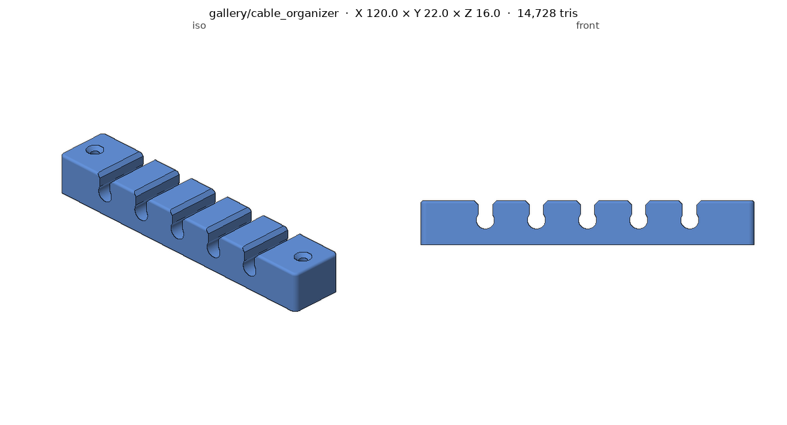
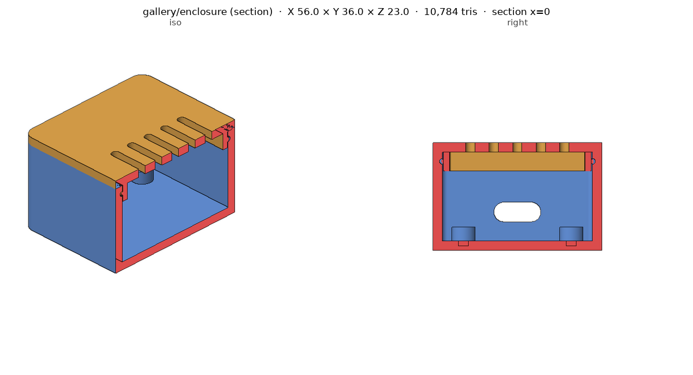
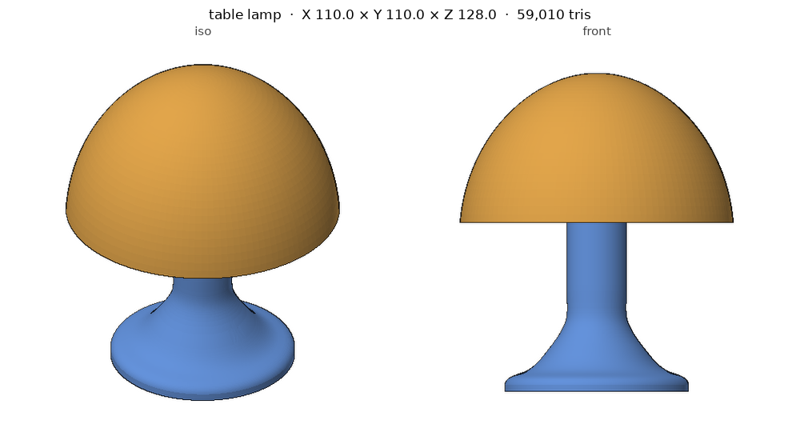
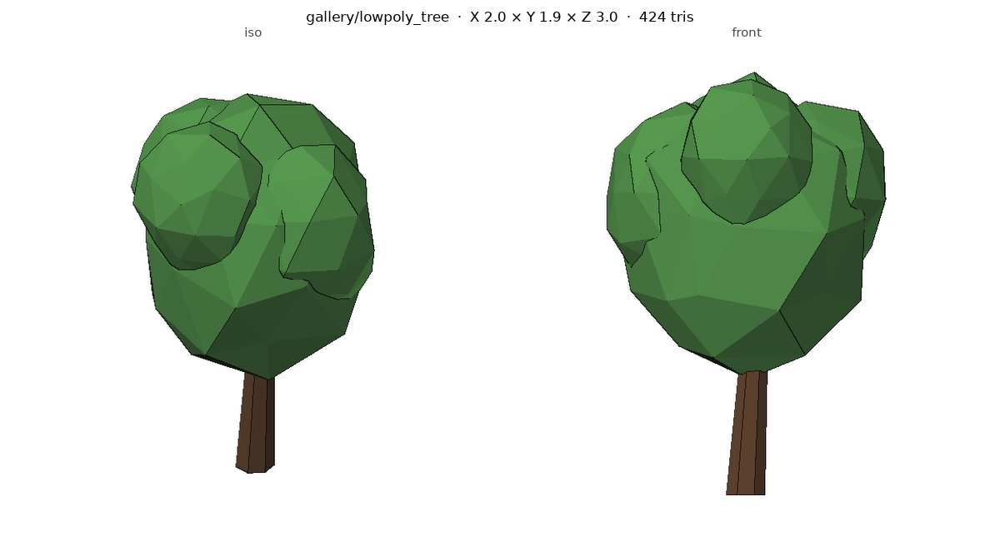

# Gallery

Results produced by an agent following `skills/3d-modeling/SKILL.md`, from the prompt
alone. Each folder has the generating script, with the prompt and the assumptions at
the top. Rebuild any of them with `python <script> --out out/`.

| Prompt | Result | Checks |
|---|---|---|
| "Make a desk cable organiser: 120 mm long, five slots for 6 mm cables, screw holes for M3." — [`cable_organizer/`](cable_organizer/cable_organizer.py) |  | one closed solid, 120 × 22 × 16 mm, no overhangs over 45°, walls ≥ 3.8 mm |
| "Design a two-part box for a 50 × 30 × 15 mm board, with a snap-fit lid and a USB-C cutout." — [`enclosure/`](enclosure/enclosure.py) |  | base and lid each one solid, zero interference when seated, four standoffs confirmed in a z-section |
| "A small table lamp like the pastel mushroom lamps: dome shade, slim stem, wide foot, room for a light module and its cable." — [`table_lamp/`](table_lamp/table_lamp.py) |  | Bezier dome revolved and hollowed (1 mm wall), trumpet base, ring + spokes joining them; two separate solids (two materials/colours), zero interference; `printable=1` adds a flat top and an overhang limit |
| "A low-poly tree prop for a three.js scene, under 1,500 triangles, as GLB." — [`lowpoly_tree/`](lowpoly_tree/lowpoly_tree.py) |  | 424 triangles, 3 m tall, Y-up GLB with origin at the base, two materials |

## What building these changed in the skill

- **Section views** (`render_views.py --section`): the enclosure's standoffs looked
  missing from outside; a cut showed all four. SKILL.md now says to confirm features
  with a section or a count before claiming they exist or not.
- **Assemblies in one render** (several files, one colour each) and **STEP / GLB input**
  with the file's own colours and glTF's Y-up handled.
- **Overhang report** (`inspect_mesh.py --overhang 45`) for printed parts.
- **Welding duplicated vertices** before topology checks: flat-shaded GLB exports were
  reported as 100+ loose pieces.
- **Profile-and-extrude pattern** for constant cross-sections (the organiser's keyhole
  channels started as stacked boxes with a stepped, not chamfered, lead-in).
- **Integer and boolean `--set` parameters** in the build123d template.
- bmesh `create_icosphere(subdivisions=1)` is a bare icosahedron; noted in the tree script.
- **Lamp shade**: a hand-offset inner curve poked through the dome top and a spline
  profile kinked under the top. Now: one `Bezier` with controlled end angles, `offset()`
  to hollow, a profile check, no curve ending exactly on the axis, and spokes trimmed
  to mid-wall. A first version also baked print rules (flat top, overhang limit) into
  the shape; they are now an option, and SKILL.md says not to add manufacturing
  constraints the user did not ask for.
